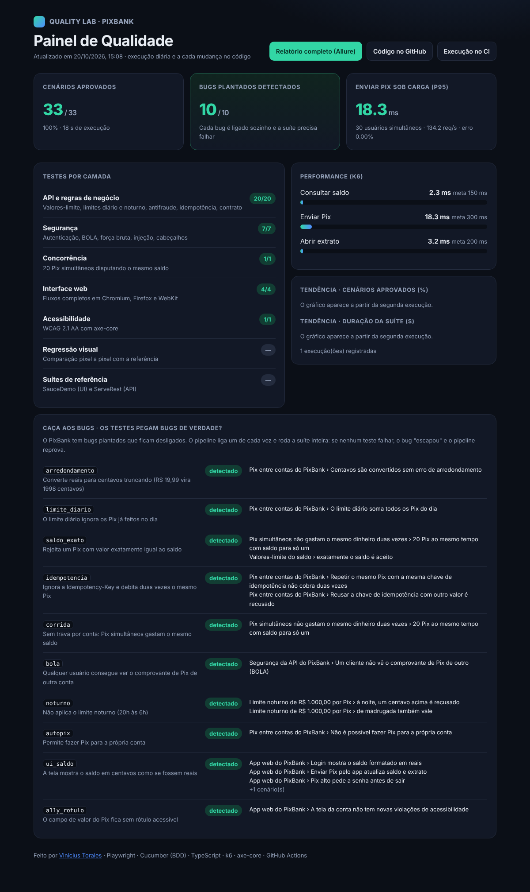
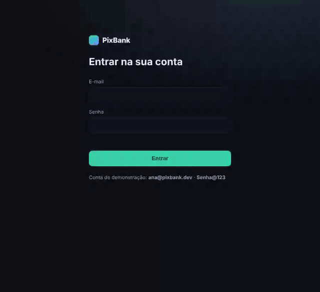
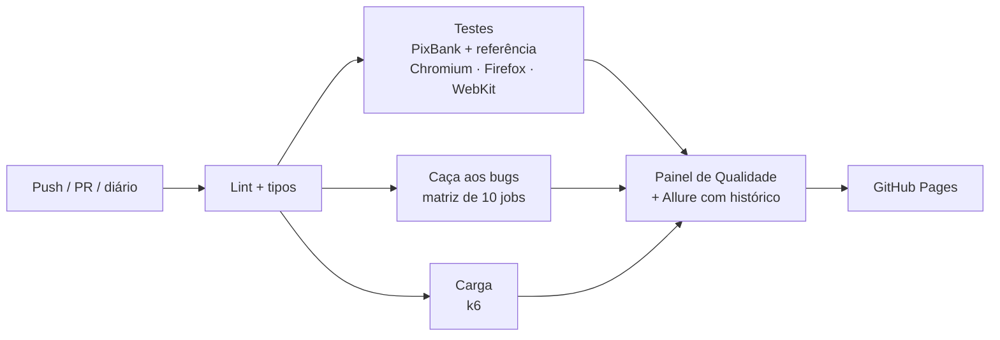
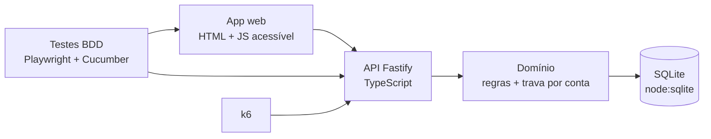
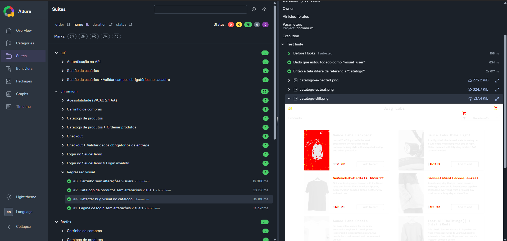
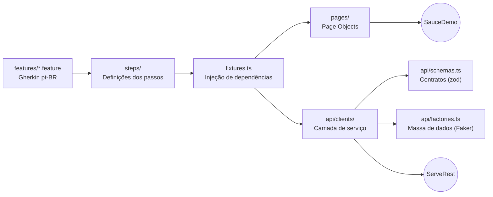
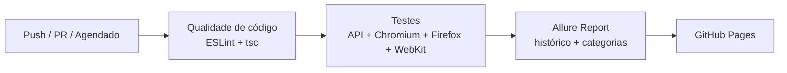
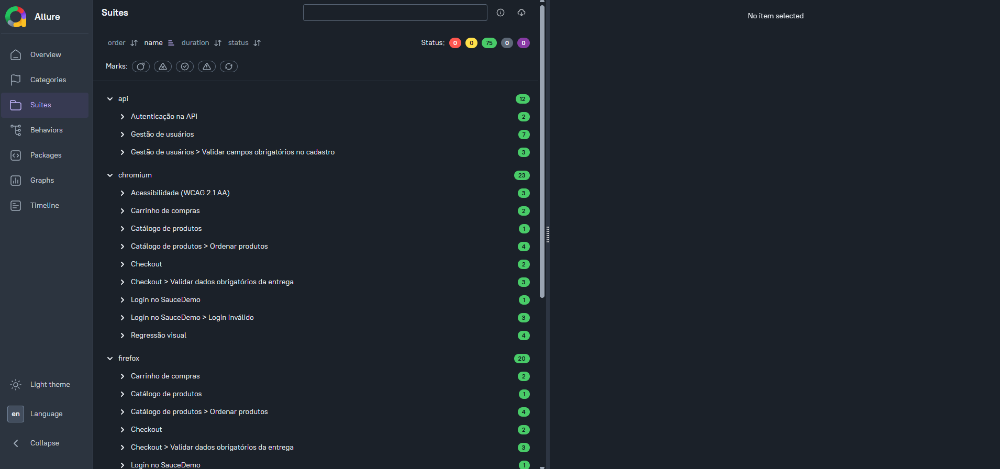

# Quality Lab · PixBank

[](https://github.com/tsvini/qa-automation-portfolio/actions/workflows/tests.yml)
[](https://tsvini.github.io/qa-automation-portfolio/)
[](https://tsvini.github.io/qa-automation-portfolio/allure/)


Uma estratégia de testes completa, aplicada a um **banco digital construído do zero para ser testado**: o **PixBank**.
Ele tem regras de negócio de verdade (limites, antifraude, idempotência) e é testado em **todas as camadas**:
API, interface em 3 navegadores, segurança, concorrência, acessibilidade, regressão visual e carga.

E tem uma prova a mais: **10 bugs plantados no código**. O pipeline liga um de cada vez e exige que a suíte falhe.
Hoje o placar é **10/10**.

### 👉 [Ver o Painel de Qualidade ao vivo](https://tsvini.github.io/qa-automation-portfolio/)



---

## O PixBank



| Regra | Como é testada |
|---|---|
| Pix debita a origem e credita o destino na hora | API (com contrato) e interface |
| Saldo: aceita exatamente o saldo, recusa 1 centavo acima | Valores-limite |
| Limite diário de R$ 5.000,00, somando todos os Pix do dia | API |
| Limite noturno (20h às 6h) de R$ 1.000,00 por Pix | API com **relógio controlado** pelo teste |
| Pix acima de R$ 2.000,00 só sai com a senha | API e interface (modal de confirmação) |
| Mesma `Idempotency-Key` não cobra duas vezes | API |
| Ninguém vê o comprovante de outro cliente (BOLA) | Segurança |
| 5 senhas erradas bloqueiam o login | Segurança |
| 20 Pix simultâneos não gastam o mesmo saldo | **Concorrência**, cada Pix na sua conexão |
| Tela acessível (WCAG 2.1 AA) | axe-core |

## A caça aos bugs

Testes que passam não provam nada sozinhos. Por isso o PixBank tem **bugs plantados**, desligados por padrão
([`app/bugs.ts`](app/bugs.ts)). No CI, uma matriz de 10 jobs liga **um bug por vez** e roda a suíte:
se nenhum cenário falhar, o bug "escapou" e o pipeline reprova.

| Bug plantado | Quem pega |
|---|---|
| `arredondamento`: R$ 19,99 vira 1998 centavos | Conversão de centavos |
| `limite_diario`: ignora os Pix já feitos | Limite diário |
| `saldo_exato`: recusa Pix igual ao saldo | Valores-limite |
| `idempotencia`: debita duas vezes | Idempotência |
| `corrida`: sem trava por conta | Concorrência |
| `bola`: comprovante de outra conta visível | Segurança |
| `noturno`: limite noturno não aplicado | Limite noturno |
| `autopix`: Pix para si mesmo | Regras de destino |
| `ui_saldo`: tela mostra centavos como reais | Interface |
| `a11y_rotulo`: campo sem rótulo | Acessibilidade |

**O que a caça aos bugs revelou na primeira rodada:** dois testes estavam passando pelo motivo errado.
- O teste de limite noturno recusava o Pix por **saldo insuficiente**, não pelo limite. Agora ele confere o **código do erro**.
- O teste de concorrência mandava os 20 Pix pela **mesma conexão HTTP**, que os enfileirava. Agora cada Pix sai por uma conexão própria, e a corrida aparece de verdade.

É exatamente o tipo de falso positivo que só aparece quando você testa os seus testes.

## Performance

Teste de carga com **k6**: 30 usuários simultâneos consultando saldo, enviando Pix e abrindo o extrato.
O pipeline reprova se o p95 passar das metas (saldo 150 ms, Pix 300 ms, extrato 200 ms) ou se a taxa de erro passar de 1%.

## Pipeline



## Arquitetura do PixBank



---

## Suítes de referência (SauceDemo e ServeRest)

Antes do PixBank, o projeto já testava aplicações públicas de demonstração. Essas suítes continuam rodando no mesmo pipeline.

### O que é testado

| Área | Aplicação | Cobertura |
|---|---|---|
| **Interface Web** | [SauceDemo](https://www.saucedemo.com) | Login, carrinho, checkout completo, validações de formulário, ordenação de produtos |
| **API REST** | [ServeRest](https://serverest.dev) | CRUD de usuários, autenticação, validação de campos e **contrato das respostas** |
| **Regressão visual** | SauceDemo | Comparação de telas com imagens de referência, incluindo um cenário que **prova a detecção de um bug visual real** |
| **Acessibilidade** | SauceDemo | Análise WCAG 2.1 AA com axe-core e baseline de violações conhecidas |

### Detecção de bug visual

O SauceDemo tem um usuário (`visual_user`) com defeitos de layout propositais. O cenário `@deteccao` confirma que a regressão visual **pega o bug**, e o relatório mostra referência, tela atual e diferença:



---

### Arquitetura



### Pipeline (referência)



O workflow também tem uma execução manual que **gera as imagens de referência visual no Linux** e faz o commit delas automaticamente.



---

### Decisões técnicas

**Por que `playwright-bdd` e não `@cucumber/cucumber`?**
Mantém o runner nativo do Playwright, com paralelismo, fixtures, retries, trace e projetos multi-browser, e ainda permite escrever cenários em Gherkin legíveis para o negócio.

**Por que validar contrato com zod?**
Status e mensagem não pegam mudanças na *estrutura* da resposta. O schema falha se um campo some, muda de tipo ou de formato, que é o tipo de quebra que mais afeta o frontend.

**Como os testes de API ficam independentes?**
Cada cenário cria seus próprios dados com Faker, e a fixture `usuariosApi` **remove tudo que foi criado** ao final. Nenhum teste depende de outro ou de dados pré-existentes, então todos rodam em paralelo com segurança.

**Por que a API roda em um projeto separado?**
Repetir chamadas HTTP em 3 navegadores não adiciona cobertura. O projeto `api` roda sem navegador, mais rápido e sem duplicação.

**Por que as imagens de referência são geradas no CI?**
A renderização de fontes e imagens muda entre sistemas operacionais. As referências são geradas no mesmo ambiente Linux em que os testes rodam, evitando falsos positivos.

**Por que acessibilidade só no Chromium?**
O axe-core analisa o HTML da página, que é o mesmo em qualquer navegador. Rodar três vezes só repetiria a mesma análise.

**Por que um baseline de acessibilidade?**
Em produto real, raramente se corrige tudo de uma vez. Violações já conhecidas ficam documentadas em `a11y/violacoes-conhecidas.json`, e o teste **falha apenas quando uma nova violação aparece**.

**Por que categorizar falhas no Allure?**
Separar "falha de produto" de "falha de infraestrutura" mostra rapidamente se o problema está no sistema ou no ambiente.

---


## Estrutura

```
├── app/                  # PixBank: API, domínio, bugs plantados e app web
├── pixbank/              # Cliente da API, contratos (zod) e Page Object do PixBank
├── features/
│   ├── pixbank/          # Pix, segurança, concorrência e interface do PixBank
│   ├── api/  ui/         # Suítes de referência (ServeRest e SauceDemo)
├── steps/                # Passos, fixtures e hooks (Allure)
├── perf/                 # Teste de carga (k6)
├── scripts/              # Caça aos bugs e geração do Painel de Qualidade
├── snapshots/            # Referências da regressão visual
└── .github/workflows/    # Pipeline
```

## Como rodar

Requer **Node 22**.

```bash
npm install
npx playwright install

npm run pixbank          # sobe o PixBank em http://localhost:3000 (ana@pixbank.dev / Senha@123)
npm run test:pixbank     # testes do PixBank
npm test                 # tudo, inclusive as suítes de referência
npm run cacar-bugs       # liga cada bug plantado e confere se a suíte pega
npm run test:perf        # carga com k6 (com o PixBank rodando)
npm run check            # lint + tipos
```

## Autor

**Vinícius Torales**, QA Automation Engineer · instrutor do curso *Cypress para leigos* na Udemy

[](https://www.linkedin.com/in/vinicius-torales/)
